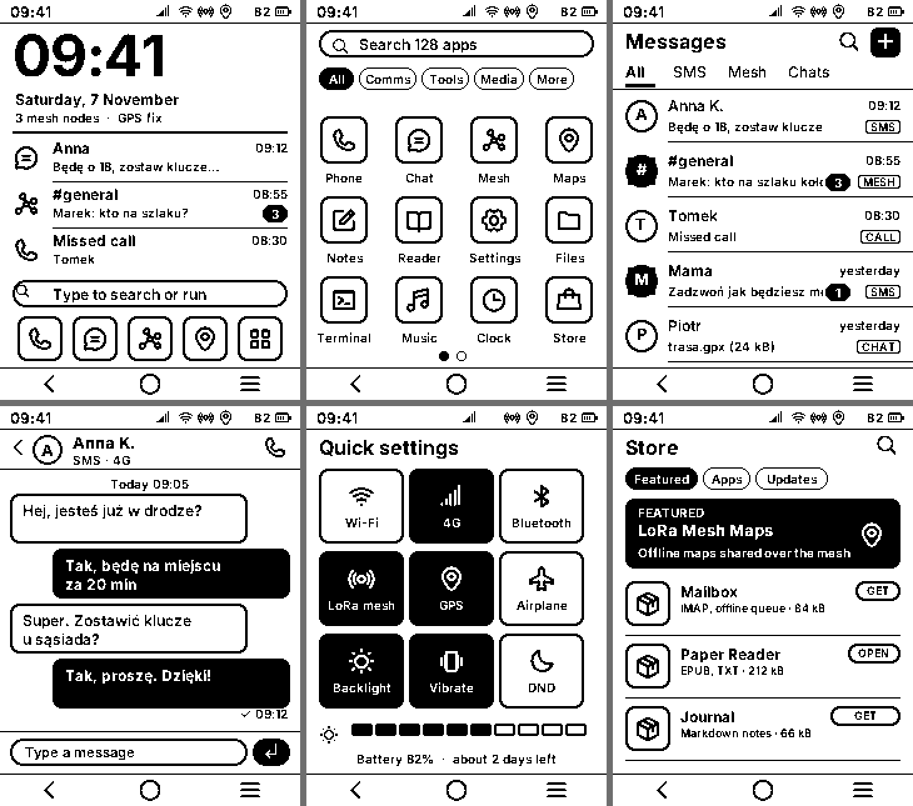

# phoneui

[](https://github.com/choco-technologies/phoneui/actions/workflows/ci.yml)

The graphical interface of a phone based on dmod: a home screen with notifications, the list of applications, one inbox for SMS, LoRa mesh
and messengers, conversations, quick settings and a store - for every kind of screen its own design, one logic behind all of them.

The first screen is the 240 x 320 e-paper of the LILYGO **T-Deck Pro** (`epaper-240x320`). The functions behind the interface - telephony,
messages, radio, settings, the store - are stubs for now: the interface is finished and designed, the functions are to be plugged in. The
first one plugged in is the Wi-Fi: its tile switches the radio of the board (docs/backend.md).



## What's here

| Module | Kind | What it is |
|--------|------|------------|
| `phoneui` | Application (service) | Claims the display for the view while it runs; sets the view's properties from a backend and runs what the view asks for |
| `phoneui_view` | Data | The views - one bundle (`phoneui.dmv` and its fonts) for each kind of screen, chosen with `dmf-get --screen <id>` |

```
screens/<screen>/index.html ──(todmvs: dmvs_html + dmvs_js)──► phoneui.dmvs + fonts ──(dmod)──► phoneui.dmv, .dmvf
                                                                                                    │
                      phoneui (src/ui.c)  ◄── properties / events (docs/contract.md) ──►  dmview (libdmview): draws, takes the touches
                              │
                      backend (src/phoneui_backend.h; the stub: src/backend_stub.c)
```

A view is a page - HTML, CSS and JavaScript - converted at build time; nothing of it is interpreted on the device. The page does not know
the phone: what it shows comes from properties the application sets, what the user does goes to the application as events. That
**contract** ([docs/contract.md](docs/contract.md)) is the same for every screen, so a new screen is a new page, not new code
([docs/screens.md](docs/screens.md)). The page is designed for its display: [docs/design-epaper.md](docs/design-epaper.md).

## Running it on dmod-boot

In the flash modules of the board (`configs/board/t-deck-pro/flash.dmd` of dmod-boot):

```text
dmview
dmview service=dmview@.ini
dmview rules=dmview.rules
phoneui service=phoneui.ini
phoneui_view @screen epaper-240x320
```

`dmview` takes the display from dmdevfs and the touches from the touch panel of the display's `friends_group`; `phoneui` claims the display
for `/eviews/phoneui_view/phoneui.dmv`, the view built into the firmware.

## Seeing it on a PC: dmvshot

`tools/dmvshot` plays the part of the display service and of the touch panel: it loads the real view, runs the real `src/ui.c` with the stub
backend, draws into a buffer of the display's format and writes the pictures - what libdmview drew, and what the e-paper shows of it.

```bash
cmake -S . -B build -DDMOD_TOOLS_NAME=arch/x86_64 -DDMOD_BUILD_TOOLS=ON && cmake --build build
dmod_loader build/dmf/dmvshot.dmf --args build/views/epaper-240x320/phoneui.dmv out \
    shot:home click:200,307 wait:600 shot:apps click:120,307 click:76,271 shot:inbox
```

Steps: `shot:<name>`, `click:<x>,<y>`, `press:<x>,<y>` (a touch that stays: a pressed button) and `release`, `wait:<ms>`, `expect:<event>`, `threshold:<n>`. The events the view emits are printed.

## Building

```bash
cmake -S . -B build -DDMOD_TOOLS_NAME=arch/xtensa/esp32s3      # an architecture (-DDMOD_DIR=<local dmod> for a local checkout)
cmake --build build
```

CMake configures by converting the pages (`todmvs` and its converters are downloaded with `dmf-get`; `-DPHONEUI_TOOLS_DIR=<dir>` uses
the ones in a directory). The tests (`ctest`) run the stub backend.

## License

MIT - see [LICENSE](LICENSE).
